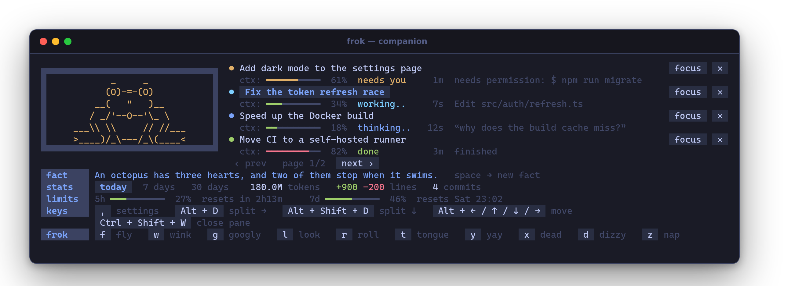
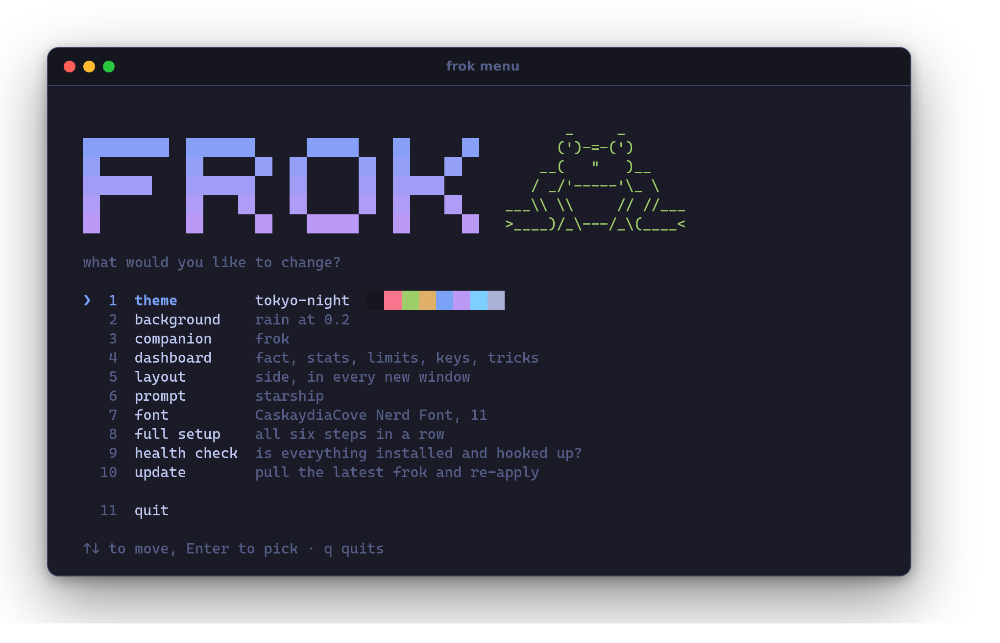
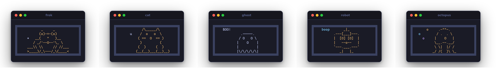
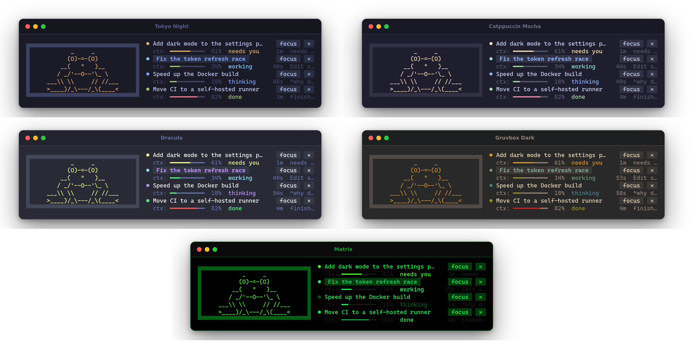

# frok

[](https://github.com/pawcza/frok/actions/workflows/test.yml)
[](LICENSE)

**A terminal upgrade for people who live in Claude Code.** One command sets up
your theme, font, prompt, CLI tools and pane layouts. You also get a companion
pane: a small animated pet that watches every Claude Code session you have open,
tells you which one needs you, and keeps an eye on your usage limits.



- **Sessions at a glance:** what each one is doing, how full its context is,
  and who's waiting for permission. Click a session to jump to its pane, or end
  it from there.
- **Usage:** your 5-hour and 7-day limits, plus tokens, lines changed and commits
  for today, the last 7 days or the last 30.
- **A pet with moods:** it squints while Claude works, goes wide-eyed when a
  session needs you and cheers when one finishes. Poke it too often and it
  leaves for a while.
- **Your terminal, themed:** five colour schemes carried through the terminal,
  prompt, fzf and companion, an animated rain background, Nerd Fonts and
  layouts that build themselves when the terminal opens.

## Install

```sh
git clone https://github.com/pawcza/frok && ./frok/install.sh
```

The installer gets `git curl jq zsh unzip` with your package manager (Homebrew,
apt, dnf, pacman, zypper, apk; on a bare Mac it installs Homebrew first) and
puts `frok` in `~/.local/bin`. Then it starts a six-step setup: theme,
background, companion, layout, prompt, font. Each choice applies as you pick it.
It only asks for your password when the system needs it. Fonts, CLI tools,
starship and the Claude Code hooks are installed by frok itself as you choose
them.

On Windows, run it inside WSL. frok configures Windows Terminal and WezTerm on
the Windows side from there, and installs fonts for your Windows user (no admin
needed).

## Using it

| | |
|---|---|
| `frok` | turns the pane you're in into the companion (the first time: the setup) |
| `frok menu` | every setting, with its current value; `,` in the companion opens it too |
| Ctrl+Shift+L | opens your layout in a new tab (Windows Terminal) |



Every setting also has a direct command:

| | |
|---|---|
| `frok theme [name]` | tokyo-night, catppuccin-mocha, gruvbox-dark, dracula, matrix (no name: list with swatches) |
| `frok background rain\|none\|<file>` | digital rain recoloured to the theme, any image or GIF, or nothing · `frok background opacity 0.2` |
| `frok companion <pet>\|none` | frok, cat, ghost, robot, octopus · `frok companion facts on\|off` |
| `frok layout [name]` | `single`, `side`, `quad`, `grid` · `frok layout open` · `frok layout autostart on` |
| `frok agent "<cmd>"` | what agent panes run (default `claude`, e.g. `ccs personal`) · `frok workdir ~/dev` |
| `frok prompt starship\|none` | |
| `frok font "<family>" [size]` | Nerd Fonts download automatically |
| `frok tools [install\|add\|remove]` | eza, bat, fd, zoxide, ripgrep, fzf, delta, lazygit, gh, btop, tldr, zsh-autosuggestions |
| `frok terminals [set …\|auto]` | which terminals to configure (detected by default) |
| `frok status`, `doctor`, `apply`, `update`, `uninstall` | |

Prefer to ask? frok installs a Claude Code skill, so "make my terminal
dracula" or "give me the quad layout" in any Claude session does the same.

## The companion



Pick a pet with `frok companion <name>`. Each one has its own art, faces and
tricks: the frog catches flies, the cat knocks a mug off the ledge, the ghost
bobs and vanishes, the robot reboots, the octopus juggles and inks. Press a
trick's key or click its chip in the footer.

| In the companion | |
|---|---|
| click a session, or its **focus** button | jump to that pane |
| **✕** (click twice) | end that Claude session; the pane keeps its shell |
| `[` `]`, or the pager | more sessions (4 to a page) |
| `p`, or click a period | stats for today · 7 days · 30 days |
| `space` | a new useless fact |
| `,`, or the settings chip | `frok menu`, right there |
| click the pet | don't |

How it works and what it stores: [companion](companion/README.md).
Adding a pet is one file: [pets](companion/pets/README.md).

## Themes



A theme colours the terminal, the prompt, fzf and the companion. Your own go in
`~/.config/frok/themes/` ([format](themes/README.md)), and your own layouts in
`~/.config/frok/layouts/` ([format](layouts/README.md)). Settings live in
`~/.config/frok/frok.json`.

## Terminals

| | Theme, font, keys | Background | Layouts | Companion: jump to pane |
|---|---|---|---|---|
| **WezTerm** (macOS, Linux, Windows) | ✓ | animated, tiled | on start | ✓ |
| **Windows Terminal** (from WSL) | ✓ | animated | on start, `frok layout open`, Ctrl+Shift+L | ✓ (panes from the layout) |
| **kitty** | ✓ | — | — | ✓ |
| anything else | prompt, tools, companion | — | — | — |

The pane keys are the same everywhere: ⌘ on macOS, Alt elsewhere.

| | macOS | elsewhere |
|---|---|---|
| split right / down | ⌘D / ⌘⇧D | Alt+D / Alt+Shift+D |
| move between panes | ⌘⌥ + arrows | Alt + arrows |
| resize | ⌘⇧ + arrows | Alt+Shift + arrows |
| zoom · close | ⌘Z · ⌘⇧W | Alt+Z · Ctrl+Shift+W |

## What frok touches

frok only edits its own files and clearly marked blocks, and keeps backups:

- one line in `~/.zshrc` / `~/.bashrc` that sources `~/.config/frok/generated/init.sh`
- **WezTerm:** `wezterm.lua` (yours is kept as `wezterm.lua.pre-frok`;
  personal tweaks go in `frok-local.lua`)
- **Windows Terminal:** a `frok <theme>` colour scheme, `User.frok.*` actions
  and keys, the startup layout and the look of your WSL profile. The originals
  are saved and `frok uninstall` puts them back; every write is also backed up
  in `~/.local/state/frok/backups`.
- **kitty:** `frok.conf`, included from `kitty.conf`
- **Claude Code**, in every config dir (`~/.claude`, `$CLAUDE_CONFIG_DIR`, ccs
  profiles): the companion's hooks, its status line (only where you have none
  of your own), and the `frok` skill

`frok uninstall` undoes all of it and keeps `~/.config/frok`.

## Repository

```
bin/frok              the command: reads the subcommand, hands it to lib/
lib/
  core.zsh            paths, output, config          packages.zsh   installing things
  commands.zsh        setup, apply, status, doctor, uninstall
  theme  layout  keys  shell  background  fonts  claude  companion   one concern each
  terminals/          detect, wezterm, windows-terminal, kitty
  wizard.zsh          the setup screens and `frok menu`
companion/            the companion pane (see its README)
  companion.zsh       main loop          parts/   panes, sessions, pet, render, input…
  companion-event.sh  Claude Code hook   statusline.sh  stats.sh   pets/
skill/                the Claude Code skill (lets Claude drive frok)
themes/  layouts/     built-in themes and layouts (JSON, see their READMEs)
shell/                the shell init and starship template frok renders
backgrounds/          the rain generator
tests/                tests/run.sh: offline, in a sandbox; runs on every push
docs/                 screenshots (rebuild with docs/screenshots/make.sh)
```

## Contributing

Run `tests/run.sh` before sending a change, and `docs/screenshots/make.sh` if
the companion or the menu look different. New pets, themes and layouts are one
file each. The READMEs next to them describe the format.

## License

[MIT](LICENSE)
