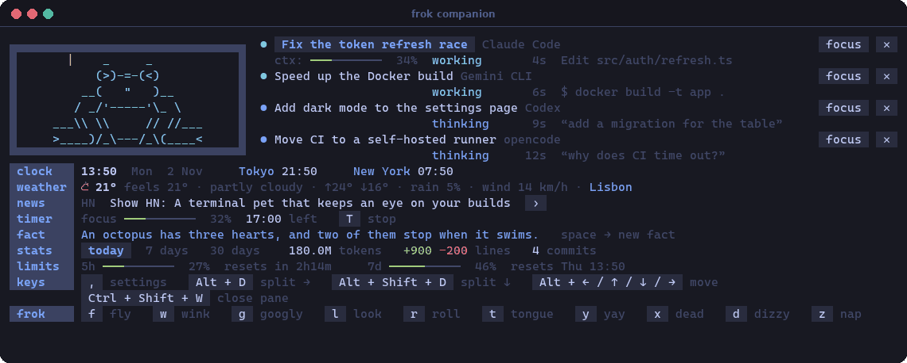
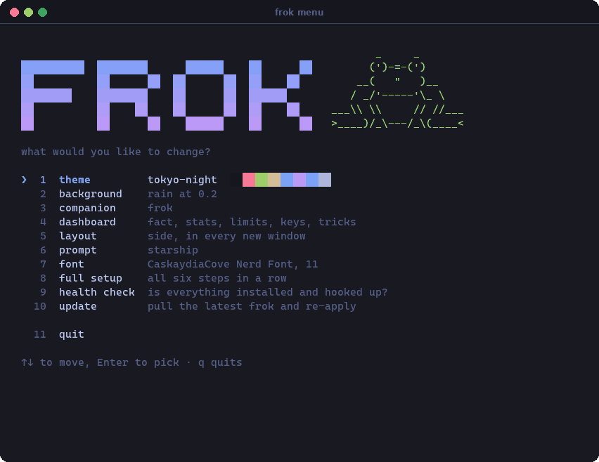
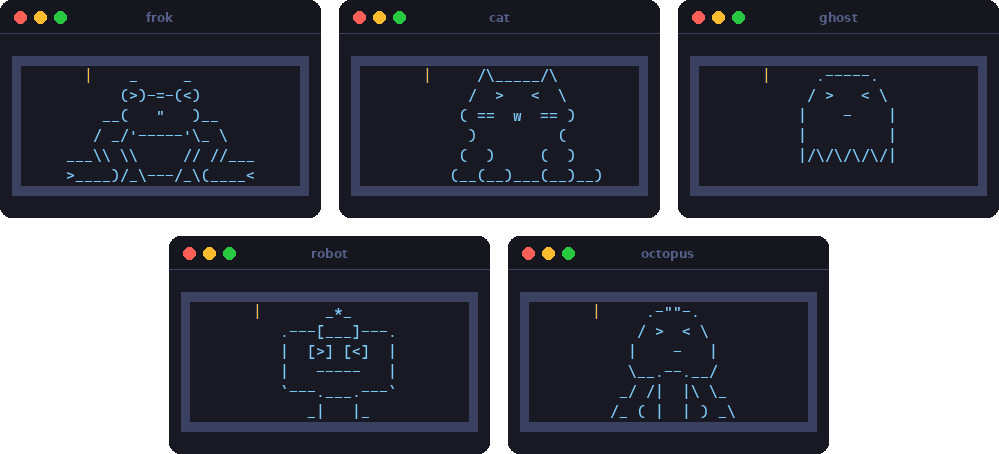
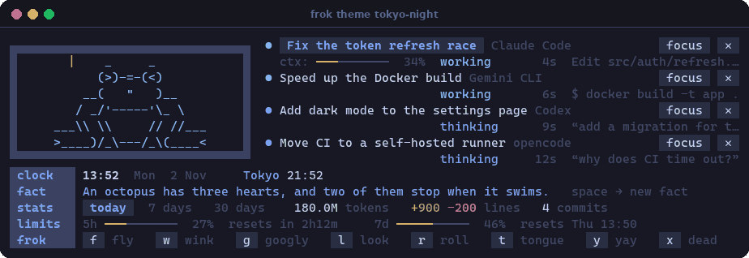
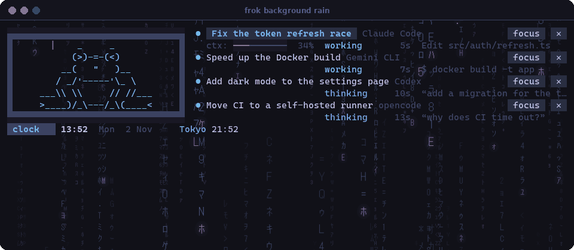

# frok

[](https://github.com/pawcza/frok/actions/workflows/test.yml)
[](LICENSE)

**A terminal upgrade you set up once.** One command gives you a theme, a
Nerd Font, a prompt, modern CLI tools, animated backgrounds and pane layouts
that build themselves when the terminal opens. A companion pane adds an animated
pet and a dashboard you choose, and if you use a coding agent, it follows your
sessions too.



- **Your terminal, themed:** five colour schemes carried through the terminal,
  prompt, fzf and companion, five animated backgrounds, and Nerd Fonts that
  install themselves.
- **Better tools, set up:** eza, bat, fd, zoxide, ripgrep, fzf, delta, lazygit,
  gh, btop, tldr and inline suggestions, with starship as your prompt.
- **Layouts:** splits for your shell, your agent and the companion, the same
  keys in every terminal.
- **A dashboard you choose:** weather, headlines, world clocks, system load, a
  focus timer and more, in whatever order you like.
- **A pet with moods:** it reacts to what's going on and does tricks when it's
  quiet. Poke it too often and it leaves for a while.
- **Agents at a glance:** Claude Code, Codex, Gemini CLI, opencode, aider or
  anything else you run in a pane: what each is doing, and which one needs you.
  [What works with which](#coding-agents).

No coding agent is needed. Without one, the companion is the pet and the
dashboard, and agent panes open a shell.

## Install

```sh
git clone https://github.com/pawcza/frok && ./frok/install.sh
```

The installer gets `git curl jq zsh unzip` with your package manager (Homebrew,
apt, dnf, pacman, zypper, apk; on a bare Mac it installs Homebrew first) and
puts `frok` in `~/.local/bin`. Then it starts a six-step setup: theme,
background, companion, layout, prompt, font. Each choice applies as you pick it.
It only asks for your password when the system needs it. Fonts, CLI tools and
starship are installed by frok itself as you choose them. Any coding agent it
finds is connected to the companion.

On Windows, run it inside WSL. frok configures Windows Terminal and WezTerm on
the Windows side from there, and installs fonts for your Windows user (no admin
needed).

## Using it

| | |
|---|---|
| `frok` | turns the pane you're in into the companion (the first time: the setup) |
| `frok menu` | every setting, with its current value; `,` in the companion opens it too |
| Ctrl+Shift+L | opens your layout in a new tab (Windows Terminal) |



Every setting also has a direct command:

| | |
|---|---|
| `frok theme [name]` | tokyo-night, catppuccin-mocha, gruvbox-dark, dracula, matrix (no name: list with swatches) |
| `frok background <effect>\|none\|<file>` | rain, starfield, snow, aurora, synthwave, all recoloured to the theme, or any image or GIF · `frok background opacity 0.2` |
| `frok companion <pet>\|none` | frok, cat, ghost, robot, octopus · `frok companion facts on\|off` |
| `frok dashboard` | the widgets under the sessions · `add\|remove <widget>` · `move <widget> <n>` · `set <widget> <option> <value>` |
| `frok layout [name]` | `single`, `side`, `quad`, `grid` · `frok layout open` · `frok layout autostart on` |
| `frok agent "<cmd>"` | what agent panes run (default: the first agent found, e.g. `codex` or `ccs work`) · `frok workdir ~/dev` |
| `frok agents` | which agents report to the companion · `on\|off <agent>` · `watch\|unwatch <command>` |
| `frok prompt starship\|none` | |
| `frok font "<family>" [size]` | Nerd Fonts download automatically |
| `frok tools [install\|add\|remove]` | eza, bat, fd, zoxide, ripgrep, fzf, delta, lazygit, gh, btop, tldr, zsh-autosuggestions |
| `frok terminals [set …\|auto]` | which terminals to configure (detected by default) |
| `frok status`, `doctor`, `apply`, `update`, `uninstall` | |

Prefer to ask? With Claude Code installed, frok adds a skill for it, so "make
my terminal dracula" or "give me the quad layout" in any session does the same.

## The companion



Pick a pet with `frok companion <name>`. Each one has its own art, faces and
tricks: the frog catches flies, the cat knocks a mug off the ledge, the ghost
bobs and vanishes, the robot reboots, the octopus juggles and inks. Press a
trick's key or click its chip in the footer.

| In the companion | |
|---|---|
| click a session, or its **focus** button | jump to that pane |
| **✕** (click twice) | end that agent; the pane keeps its shell |
| `[` `]`, or the pager | more sessions (4 to a page) |
| `p`, or click a period | stats for today · 7 days · 30 days |
| `space` · `N` · `T` | a new fact · the next headline · start / stop the focus timer |
| `,`, or the settings chip | `frok menu`, right there |
| click the pet | don't |

### The dashboard

Under the sessions sits a dashboard of widgets you pick and order:

| | |
|---|---|
| `clock` | time, date and world clocks |
| `weather` | now and today for your city (Open-Meteo, no key) |
| `news` | Hacker News or any RSS / Atom feeds; click a headline to open it |
| `system` | CPU, memory, disk, battery |
| `timer` | a focus timer: `T` to start, the pet cheers when it's done |
| `fact` `keys` `tricks` | the defaults |
| `stats` `limits` | also defaults: tokens, lines, commits and the 5-hour and 7-day limits. Claude Code only, and hidden when there's nothing to show |

```sh
frok dashboard add weather 1                # at the top
frok dashboard set weather city Kraków
frok dashboard set clock zones "Tokyo=Asia/Tokyo, New York=America/New_York"
frok dashboard set news feeds "hn, https://www.theverge.com/rss/index.xml"
```

Or `frok menu` › dashboard. Open companions update straight away. Writing your
own widget is one file: [widgets](companion/widgets/README.md).

How it works and what it stores: [companion](companion/README.md).
Adding a pet is one file: [pets](companion/pets/README.md).

## Coding agents

frok finds the agents you have installed and asks once before connecting each
one, because their settings are theirs. What the companion can show depends on
what the agent reports:

| Agent | Connected through | Status | Needs you | Session name | Context, limits, stats | How frok tested it |
|---|---|---|---|---|---|---|
| **Claude Code** | hooks, status line, transcripts | ✓ | ✓ | ✓ | ✓ | fixtures; the hooks in everyday use |
| **Codex CLI** | hooks (`~/.codex/hooks.json`). Run `/hooks` in Codex once: it skips new hooks until you trust them | ✓ | ✓ | latest prompt | not shown | fixtures from Codex's published schemas, not a live run |
| **Gemini CLI** | hooks (`~/.gemini/settings.json`) | ✓ | ✓ | latest prompt | not shown | fixtures from its docs and the 0.66 source, not a live run |
| **opencode** | a plugin (`~/.config/opencode/plugins/`) | ✓ | ✓ | its own title | not shown | the real plugin under Node, with events shaped from the 1.19 SDK types, not inside opencode |
| **aider** | its notification command (`~/.aider.conf.yml`) | reply finished only | no | folder, where the terminal tells it | not shown | a stand-in process that runs the command the way aider's source does, not aider itself |
| **Antigravity CLI** (`agy`) | found by process | running only | no | folder, where the terminal tells it | not shown | a stand-in process |
| **anything else** | `frok agents watch <command>`, found by process | running only | no | folder, where the terminal tells it | not shown | a stand-in process |

"Fixtures" means payloads in the agent's documented format, replayed through the
real hook by `tests/run.sh`. No agent but Claude Code is installed where these
tests were written, so the others have not been run live yet. Reports welcome.

Only Claude Code reports context, limits and token stats. For every other agent
those bars and rows stay hidden. Jumping to a session's pane and ending it use
the same pane code for every agent, but only Claude Code has been tried in a real
terminal.

A few things to know:

- aider reports once, when it finishes a reply or asks a question. It has no
  signal for starting work, so a session keeps saying "done" until the next
  reply, and aider rings the terminal bell when notifications are on.
- Google has moved individual users from Gemini CLI to Antigravity CLI. Gemini CLI
  keeps working with API keys. Antigravity's hooks take part in its permission
  decisions, which a status display has no business doing, so frok only looks
  for its process.
- `frok agents on <agent>` connects an agent later, `frok agents off <agent>`
  removes frok's entries and keeps them out, and `frok apply --yes` connects every
  agent it finds without asking, for scripts.
- Adding an agent is a small job: [agents](companion/agents/README.md).

## Themes



A theme colours the terminal, the prompt, fzf and the companion. Your own go in
`~/.config/frok/themes/` ([format](themes/README.md)), and your own layouts in
`~/.config/frok/layouts/` ([format](layouts/README.md)). Settings live in
`~/.config/frok/frok.json`.

## Backgrounds



Rain, starfield, snow, aurora and synthwave: seamless loops generated for your
theme the first time you pick them (`frok background aurora`), shown behind the
terminal at the opacity you set. How they're made, and adding one:
[backgrounds](backgrounds/README.md).

## Terminals

| | Theme, font, keys | Background | Layouts | Companion: jump to pane |
|---|---|---|---|---|
| **WezTerm** (macOS, Linux, Windows) | ✓ | animated, tiled | on start | ✓ |
| **Windows Terminal** (from WSL) | ✓ | animated | on start, `frok layout open`, Ctrl+Shift+L | ✓ (panes from the layout) |
| **kitty** | ✓ | — | — | ✓ |
| anything else | prompt, tools, companion | — | — | — |

The pane keys are the same everywhere: ⌘ on macOS, Alt elsewhere.

| | macOS | elsewhere |
|---|---|---|
| split right / down | ⌘D / ⌘⇧D | Alt+D / Alt+Shift+D |
| move between panes | ⌘⌥ + arrows | Alt + arrows |
| resize | ⌘⇧ + arrows | Alt+Shift + arrows |
| zoom · close | ⌘Z · ⌘⇧W | Alt+Z · Ctrl+Shift+W |

## What frok touches

frok only edits its own files and clearly marked blocks, and keeps backups:

- one line in `~/.zshrc` / `~/.bashrc` that sources `~/.config/frok/generated/init.sh`
- **WezTerm:** `wezterm.lua` (yours is kept as `wezterm.lua.pre-frok`;
  personal tweaks go in `frok-local.lua`)
- **Windows Terminal:** a `frok <theme>` colour scheme, `User.frok.*` actions
  and keys, the startup layout and the look of your WSL profile. The originals
  are saved and `frok uninstall` puts them back; every write is also backed up
  in `~/.local/state/frok/backups`.
- **kitty:** `frok.conf`, included from `kitty.conf`
- **Claude Code**, in every config dir (`~/.claude`, `$CLAUDE_CONFIG_DIR`, ccs
  profiles): the companion's hooks, its status line (only where you have none
  of your own), and the `frok` skill
- **Codex, Gemini CLI, opencode, aider**, only if installed: the entries or file
  listed under [Coding agents](#coding-agents). Your own hooks stay, and aider's
  config is left alone if it already has notification settings.

`frok uninstall` undoes all of it and keeps `~/.config/frok`.

## Repository

```
bin/frok              the command: reads the subcommand, hands it to lib/
lib/
  core.zsh            paths, output, config          packages.zsh   installing things
  commands.zsh        setup, apply, status, doctor, uninstall
  theme  layout  keys  shell  background  fonts  companion   one concern each
  agents.zsh          which coding agents are here and how they connect
  agents/             one file per agent: claude, codex, gemini, opencode, aider
  terminals/          detect, wezterm, windows-terminal, kitty
  wizard.zsh          the setup screens and `frok menu`
companion/            the companion pane (see its README)
  companion.zsh       main loop          parts/   panes, sessions, pet, widgets, render, input…
  companion-event.sh  the hook agents call   statusline.sh  stats.sh   pets/  widgets/
  agents/             each agent's events, mapped to one vocabulary (see its README)
skill/                the Claude Code skill (lets Claude drive frok)
themes/  layouts/     built-in themes and layouts (JSON, see their READMEs)
shell/                the shell init and starship template frok renders
backgrounds/          the animated backgrounds (frokbg package, see its README)
tests/                tests/run.sh: offline, in a sandbox; runs on every push
docs/                 the GIFs in this README (rebuild with docs/screenshots/make.sh)
```

## Contributing

Run `tests/run.sh` before sending a change, and `docs/screenshots/make.sh` if
the companion or the menu look different. New pets, widgets, themes and layouts
are one file each. The READMEs next to them describe the format.

## License

[MIT](LICENSE)
